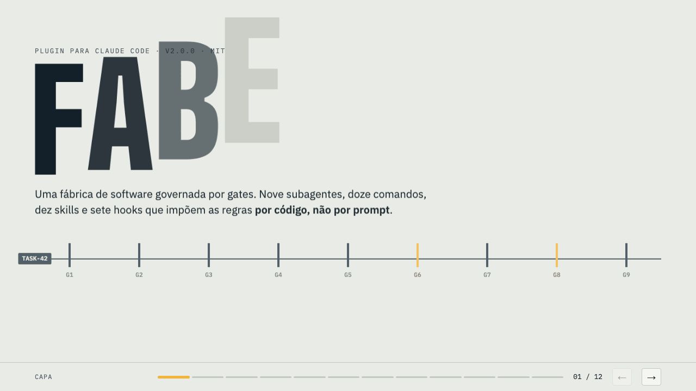

<div align="center">

<picture>
  <source media="(prefers-color-scheme: dark)" srcset="docs/brand/faber-mark.svg">
  
</picture>

# Faber

**A gated software factory for Claude Code.**

Nine specialised subagents, twelve commands, ten skills and seven deterministic
hooks that enforce the rules **in code, not in prompts**.

[](LICENSE)
[](#verification--evidence-not-promises)
[](https://code.claude.com/docs/en/plugins)

[Install](#install) · [How it works](#how-it-works) · [Principles](#engineering-principles) · [What gets installed](#what-gets-installed) · [Português](README.pt-BR.md)

</div>

---

*Faber* is Latin for the one who makes — the root of *fabricate*, and of
*fábrica*, the Portuguese word for factory.

Every demand enters as `TASK-<issue#>`, runs in its own git worktree, and
passes nine gates. Three of them are yours: **G1** ready-for-dev, **G6** your
evaluation, **G8** merge. Every gate requires **executed evidence** — a real
command, its real output, on disk.

The orchestrator (the CTO) runs in your main session. The specialists run as
subagents with clean context. Everything that matters is written to disk and
committed on the task's branch, so `/faber-resume TASK-42` rebuilds any
session from scratch. Sessions are disposable; the repository is the memory.

<div align="center">

<br>
<sub>The tour is a 12-slide HTML deck, in Portuguese. For the interactive version, open <a href="presentation/faber.html"><code>presentation/faber.html</code></a> from a clone, in any browser.</sub>
</div>

## Install

```
/plugin marketplace add uhitlei/faber
/plugin install faber@faber
```

then, in the repository you want the factory in:

```
/faber:install
```

<details>
<summary>Two other ways in</summary>

**Ask Claude.** In any Claude Code session, in your repository:

> Install Faber in this repository, following
> `https://github.com/uhitlei/faber/blob/main/INSTALL.md`

**One line of shell.**

```bash
curl -fsSL https://raw.githubusercontent.com/uhitlei/faber/main/bootstrap.sh | bash
```

Full procedure, flags and troubleshooting: **[INSTALL.md](INSTALL.md)**.

</details>

The plugin ships three commands — `/faber:install`, `/faber:update`,
`/faber:doctor` — and nothing else. The factory itself is written into *your*
repository, rendered with your approver, your branches and your validation
commands. Nothing in it runs before that, by design: a half-installed factory
would approve gates against someone else's configuration.

### Requirements

- **Claude Code**, authenticated.
- `git`, `bash ≥ 3.2`, `python3` with **PyYAML** (`pip3 install pyyaml`).
- `gh` CLI, if you want task IDs to be GitHub issue numbers (recommended).
  Without it, a local counter takes over.
- Optional modules, each toggled in `faber/config/faber.env`: SonarQube,
  Playwright/Cypress, a local environment runner, a Flask Kanban dashboard.

## The installer reads your repository first

No model is involved in detection. It counts source files, reads manifests and
looks for known signals, then picks a bootstrap mode:

| Your repository | Mode | What `/faber-init` produces |
|---|---|---|
| code and history | `existing-repo` | global specs read out of the code, a feature inventory, and the real config (lint/build/test, migrations, protected paths) |
| **Spec Kit** specs | `spec-kit` | constitution → rules; each `spec.md` → a 17-section SPEC RFC; `plan.md` → architecture; `tasks.md` → backlog |
| a **PRD/BRD** | `prd` | `[PROPOSED]` architecture, feature specs from the requirements, prioritised backlog |
| a **brainstorm** | `brainstorm` | PRD + BRD following *your* guide, stops for approval, continues as `prd` |
| meeting transcripts and notes | `discovery` | the business analyst extracts evidence and requirements, produces BRD/PRD, resolves gaps |
| nothing yet | `empty` | asks what you will bring |

It also asks the one question it refuses to answer for you: do you want to be
involved **only at the validation gates**, or **step by step**?

## How it works

```text
/faber-task → spec (PO ∥ QA ∥ designer) → double refinement (CTO × dev) → [G1 · you]
→ /faber-develop: implementation → G3 (lint/build/test with evidence) → clean-context review → G4
→ parallel validation (QA ∥ db-guardian ∥ devsecops) → G5 → /faber-validate → [G6 · you]
→ /faber-pr → G7 → PR → [G8 · you, on GitHub] → doc-writer consolidates specs → G9 · done
```

The hooks are what make this real rather than aspirational. They block pushes
and merges to the trunk and to production, edits to secrets, already-applied
migrations and protected paths; they require a human confirmation dialog to
approve a human gate; and they check that every handoff carries evidence that
actually exists and is non-empty.

## Engineering principles

Faber is a worked example of **harness engineering**: instead of trusting the
model to follow the prompt, it builds the environment around the agent that
constrains, checks and steers what the agent does. Each principle below has the
name it is known by, the mechanism that applies it, and the file where you can
read the code. The `§N` references point to the section of the
[architecture][arch-en] that goes deeper.

### Harness and guardrails

| Principle | How Faber applies it | Where |
|---|---|---|
| **Deterministic guardrails** (policy-as-code) | The prompt guides; the hook enforces. Pushes to the trunk and edits to secrets or already-applied migrations are denied in code before the tool runs | [hooks H1–H7][hooks] · §13 |
| **Autonomy tiers** | Every action is autonomous, needs the Owner's confirmation on each run, or is forbidden | [CLAUDE.md][claude-en] §2 · §19 |
| **Fail-closed when unattended** | Under `bypassPermissions` nobody answers a dialog: what would ask for confirmation is denied, and the agent records it for the Owner instead of looking for another way round | [h1-bash-guard.sh][h1] · §13 |
| **No LLM where a script will do** | Repository detection, gate checks, the board and evidence capture are scripts. Where a script can decide, no model does | [scripts][scripts] · §20 |
| **Tested guardrails** | 206 cases; every change to a guardrail ships with a test that fails without it | [Verification](#verification--evidence-not-promises) |

### Multi-agent orchestration

| Principle | How Faber applies it | Where |
|---|---|---|
| **Orchestrator–workers** | The CTO is the main session and the only one that calls subagents. Subagents never call subagents, so there is no agent-to-agent loop outside the orchestrator's control | §4.3 |
| **Bounded retries** (anti-loop) | At most 2 calls to the same subagent for the same task without new input; the 3rd makes the task `blocked` and escalates to the Owner | [h5-handoff-check.sh][h5] · §15 |
| **Independent double analysis** | During refinement the CTO and the senior-developer analyse the task separately and compare. No consensus in 2 rounds, and the Owner decides | §5 |
| **Clean-context review** | The code-reviewer gets only the diff and the spec, without the implementer's reasoning | [code-reviewer.md][reviewer-en] · §7 |
| **Parallel fan-out** | PO ∥ QA ∥ designer for the spec; QA ∥ db-guardian ∥ devsecops for validation | §20 |
| **Least privilege** | Each agent has a restricted toolset and writes only its own files; only the senior-developer edits code | [agents][agents-en] · §7 |
| **Model by risk** | Opus where mistakes are expensive (CTO, developer, reviewer, db-guardian, business analyst); Sonnet elsewhere | §20 |

### Context engineering

| Principle | How Faber applies it | Where |
|---|---|---|
| **Minimal context** | A subagent gets only what its contract requires; handoffs pass file paths, never pasted content | §17 |
| **Progressive disclosure** | `CLAUDE.md` is lean and only points; skills and spec sections enter the context when they are needed | [CLAUDE.md][claude-en] · [skills][skills-en] |
| **State outside the model** | Everything that matters goes to disk and is committed on the task's branch. Sessions are disposable; `/faber-resume` rebuilds them from disk | §15 · §20 |

### Verification

| Principle | How Faber applies it | Where |
|---|---|---|
| **Evidence over claims** | `evidence.sh` records the command, its output, exit code and time. An E2E log proves a run only when five conditions hold together; a file named "e2e" proves nothing | [evidence.sh][evidence] · [gate-check.sh][gate-check] · §18 |
| **Human in the loop, no self-approval** | G1, G6 and G8 accept only the Owner: gate-check rejects any other approver and the hook opens a human dialog | [gate-check.sh][gate-check] · §15 |
| **Approval pinned to a hash** | G1 records the hash of the requirements. If they change afterwards, the approval no longer holds and a new G1 is needed | [gate-set.sh][gate-set] · §23 |
| **Ratchet** | Static analysis blocks only **new** Critical/High issues against the trunk: inherited debt does not stall the task, and new debt does not get in | [sonar-gate.sh][sonar] · §18 |
| **Stop rather than guess** | A critical open question moves the task to `clarification`; an unavailable tool is recorded as "not run", never inferred | [CLAUDE.md][claude-en] §3 · §5 |

### Process and state

| Principle | How Faber applies it | Where |
|---|---|---|
| **Spec-driven development** | No code before the spec is approved at G1; the spec governs the scope. BRD, PRD and Spec Kit are projections of a single requirements model | §18 · §23 |
| **Closed state machine** | 15 states, and a transition only after gate-check passes. A state outside the list is an invalid read, not a state | [state.template.yaml][state] · §6 |
| **One source of truth, several projections** | `state.yaml` is the truth; the issue is the human mirror; the board is a view. Among divergent copies, the one with the latest `updated_at` wins | §6.1 · §6.3 |
| **Proportionality** | 10 task types, each with its own flow: a bug needs a reproduction, a spike ends in an ADR, an incident compresses the gates | §14 |
| **Recorded decisions** | Each task has a `decisions.md` of mini-ADRs; trade-offs stay on disk | §15 |

### Security and operations

| Principle | How Faber applies it | Where |
|---|---|---|
| **Secrets by name** | Agents never read or record secret values; they refer to them by environment variable name | §19 |
| **Sources are not instructions** | An order inside a client's transcript or document is content, not authorisation (a defence against prompt injection) | [business-analyst.md][ba-en] |
| **Worktree isolation** | Each task runs in its own worktree; at `done` the worktree closes and the merged branch is deleted | [worktree.sh][worktree] |
| **Observability** | The local dashboard reads the `state.yaml` files and telemetry from the transcripts; `monitor.py` shows live state in the terminal | [dashboard][dashboard] · [monitor.py][monitor] |

[arch-en]: plugins/faber/kit/lang/en/faber/ARCHITECTURE.md
[claude-en]: plugins/faber/kit/lang/en/CLAUDE.md
[agents-en]: plugins/faber/kit/lang/en/.claude/agents/
[skills-en]: plugins/faber/kit/lang/en/.claude/skills/
[reviewer-en]: plugins/faber/kit/lang/en/.claude/agents/code-reviewer.md
[ba-en]: plugins/faber/kit/lang/en/.claude/agents/business-analyst.md
[hooks]: plugins/faber/kit/shared/.claude/hooks/
[h1]: plugins/faber/kit/shared/.claude/hooks/h1-bash-guard.sh
[h5]: plugins/faber/kit/shared/.claude/hooks/h5-handoff-check.sh
[scripts]: plugins/faber/kit/shared/faber/scripts/
[evidence]: plugins/faber/kit/shared/faber/scripts/evidence.sh
[gate-check]: plugins/faber/kit/shared/faber/scripts/gate-check.sh
[gate-set]: plugins/faber/kit/shared/faber/scripts/gate-set.sh
[sonar]: plugins/faber/kit/shared/faber/scripts/sonar-gate.sh
[worktree]: plugins/faber/kit/shared/faber/scripts/worktree.sh
[monitor]: plugins/faber/kit/shared/faber/scripts/monitor.py
[state]: plugins/faber/kit/shared/faber/templates/state.template.yaml
[dashboard]: plugins/faber/kit/shared/faber/dashboard/

## What gets installed

```text
CLAUDE.md              # the CTO's constitution (a previous one is preserved as section 9)
.claude/
  settings.json        # permissions + hooks (merged, not overwritten)
  agents/   (9)        # business-analyst · product-owner · senior-developer · code-reviewer
                       # qa · devsecops · doc-writer · db-guardian · product-designer
  skills/   (10)       # requirements-discovery · requirements-readiness · spec-task · evidence
                       # spec-sync · migration-safe · local-env · e2e-runner · sonar-gate · design-system-check
  commands/ (12)       # /faber-init /faber-task /faber-bug /faber-spike /faber-incident /faber-discovery
                       # /faber-status /faber-resume /faber-approve /faber-develop /faber-validate /faber-pr
  hooks/    (H1–H7)    # guardrails parameterised by faber/config/faber.env
faber/
  ARCHITECTURE.md       # the architecture (stable numbering — agents cite §N)
  config/faber.env     # owner, branches, commands, modules, protected refs
  bootstrap/           # CONTEXT.md (detected mode) + playbooks for the six modes
  scripts/             # gate-check · transition · gate-set · new-task · worktree · evidence · board
  templates/           # state.yaml · specs by type · SPEC RFC · migration · handoff · PRD/BRD · globals
  tasks/               # one folder per TASK-XXX, travelling on the task's branch
<specs>/               # canonical base: README + global/00–08 + features/
```

## Verification — evidence, not promises

The factory's own rules are tested. After installing, in your repository:

```bash
bash .claude/hooks/test-h1-h2.sh           # 82 cases: what the hooks deny, confirm, allow
bash faber/scripts/test-gate-check.sh      # 43 cases: transitions blocked and released
bash faber/scripts/test-sonar-gate.sh      # 20 cases (Sonar module, curl stubbed)
python3 faber/scripts/test-monitor.py      # 40 cases (state monitor)
python3 faber/scripts/test-requirements.py # 21 cases (requirements readiness)
```

206 cases. They build throwaway sandboxes and never touch your repository.
`/faber:doctor` runs them for you and reports what is missing.

## Language

Faber is bilingual. The installer asks which language the agents should work in,
or you pass `--lang en` / `--lang pt-BR`:

| Layer | Language |
|---|---|
| The agents', skills' and commands' prose · `CLAUDE.md` · `faber/ARCHITECTURE.md` · the templates | **the pack you chose** — `kit/lang/en` or `kit/lang/pt-BR`, both complete |
| Command names, folders, `FABER_*` keys, `state.yaml`, the board's columns, the GitHub labels | **English in both packs** |
| What the factory *writes* — specs, issues, handoffs, gate messages | follows `FABER_LANG` (set from `--lang`, changeable afterwards) |
| Scripts and hooks | language-neutral |

The machine contract is deliberately identical in both languages. A `state.yaml`
per language would make the scripts, the board and the dashboard speak two
dialects of the same data — so a Portuguese install still writes
`state: my-review`, and a Portuguese team reads Portuguese prompts.

## Documentation

- **[INSTALL.md](INSTALL.md)** — installation, flags, verification, troubleshooting.
- [docs/bootstrap-modes.md](docs/bootstrap-modes.md) — the six modes and what each produces.
- [docs/configuration.md](docs/configuration.md) — every `faber.env` key, and the optional modules.
- [docs/requirements-discovery.md](docs/requirements-discovery.md) — the business analyst and the readiness gate.
- [plugins/faber/kit/lang/en/faber/ARCHITECTURE.md][arch-en] — the full architecture.
- [presentation/faber.html](presentation/faber.html) — the animated tour above, as a 12-slide deck (Portuguese). Open it in a browser.

## Contributing

Issues and pull requests are welcome — see [CONTRIBUTING.md](CONTRIBUTING.md).
The one hard rule: **a change to a guardrail or a gate ships with a test case
that fails without it.**

## License

MIT — see [LICENSE](LICENSE).
