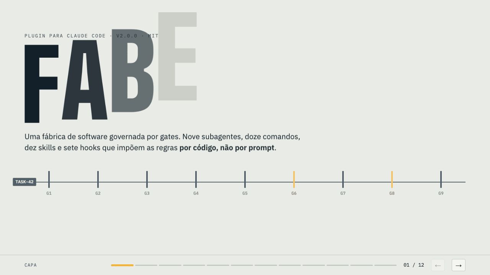

<div align="center">

<picture>
  <source media="(prefers-color-scheme: dark)" srcset="docs/brand/faber-mark.svg">
  
</picture>

# Faber

**Uma fábrica de software governada por gates, para o Claude Code.**

Nove subagentes especializados, doze comandos, dez skills e sete hooks
determinísticos que impõem as regras **por código, não por prompt**.

[](LICENSE)
[](#verificação--evidência-não-promessa)
[](https://code.claude.com/docs/en/plugins)

[Instalar](#instalação) · [Como funciona](#como-funciona) · [Princípios](#princípios-de-engenharia) · [O que é instalado](#o-que-é-instalado) · [English](README.md)

</div>

---

*Faber* é o latim para **quem faz** — a raiz de *fabricar* e de *fábrica*.

Cada demanda nasce como `TASK-<issue#>`, roda em worktree próprio e passa por
nove gates. Três são seus: **G1** ready-for-dev, **G6** sua avaliação, **G8**
merge. Cada gate exige **evidência executada** — um comando real, a saída real
dele, gravada em disco.

O orquestrador (o CTO) roda na sua sessão principal. Os especialistas rodam
como subagentes com contexto limpo. Tudo que importa vai a disco e é commitado
na branch da demanda, então `/faber-resume TASK-42` reconstrói qualquer sessão
do zero. Sessões são descartáveis; o repositório é a memória.

<div align="center">

<br>
<sub>O tour é um deck HTML de 12 slides. Para a versão interativa, abra <a href="presentation/faber.html"><code>presentation/faber.html</code></a> a partir de um clone, em qualquer navegador.</sub>
</div>

## Instalação

```
/plugin marketplace add uhitlei/faber
/plugin install faber@faber
```

depois, dentro do repositório onde você quer a fábrica:

```
/faber:install
```

<details>
<summary>Outras duas portas de entrada</summary>

**Peça para a IA.** Em qualquer sessão do Claude Code, no seu repositório:

> Instale o Faber neste repositório seguindo
> `https://github.com/uhitlei/faber/blob/main/INSTALL.pt-BR.md`

**Uma linha de shell.**

```bash
curl -fsSL https://raw.githubusercontent.com/uhitlei/faber/main/bootstrap.sh | bash
```

Procedimento completo, flags e diagnóstico: **[INSTALL.pt-BR.md](INSTALL.pt-BR.md)**.

</details>

O plugin entrega três comandos — `/faber:install`, `/faber:update`,
`/faber:doctor` — e nada mais. A fábrica em si é escrita dentro do **seu**
repositório, renderizada com o seu aprovador, as suas branches e os seus
comandos de validação. Nada nela funciona antes disso, de propósito: uma
fábrica meio instalada aprovaria gates contra a configuração de outra pessoa.

### Pré-requisitos

- **Claude Code** autenticado.
- `git`, `bash ≥ 3.2`, `python3` com **PyYAML** (`pip3 install pyyaml`).
- `gh` CLI, se quiser que o ID da demanda seja o número da issue no GitHub
  (recomendado). Sem ele, um contador local assume.
- Módulos opcionais, cada um ligado em `faber/config/faber.env`: SonarQube,
  Playwright/Cypress, subida de ambiente local, dashboard Kanban em Flask.

## O instalador lê o seu repositório primeiro

Nenhum modelo participa da detecção. Ele conta arquivos de código, lê
manifestos e procura sinais conhecidos, e então escolhe o modo de bootstrap:

| Seu repositório | Modo | O que o `/faber-init` produz |
|---|---|---|
| tem código e histórico | `existing-repo` | specs globais lidas do código, inventário de features e a configuração real (lint/build/test, migrations, paths protegidos) |
| specs em **Spec Kit** | `spec-kit` | constituição → regras; cada `spec.md` → SPEC RFC de 17 seções; `plan.md` → arquitetura; `tasks.md` → backlog |
| um **PRD/BRD** | `prd` | arquitetura `[PROPOSTA]`, specs de feature derivadas dos requisitos, backlog priorizado |
| um **brainstorm** | `brainstorm` | PRD + BRD seguindo o **seu** guia, para para aprovação, segue como `prd` |
| transcrições e notas de reunião | `discovery` | o business analyst extrai evidências e requisitos, gera BRD/PRD e resolve lacunas |
| nada ainda | `empty` | pergunta qual insumo você vai trazer |

E faz a única pergunta que ele se recusa a responder por você: você quer ser
chamado **só nos gates de validação** ou **passo a passo**?

## Como funciona

```text
/faber-task → spec (PO ∥ QA ∥ designer) → refinamento duplo (CTO × dev) → [G1 · você]
→ /faber-develop: implementação → G3 (lint/build/test com evidência) → review de contexto limpo → G4
→ validações paralelas (QA ∥ db-guardian ∥ devsecops) → G5 → /faber-validate → [G6 · você]
→ /faber-pr → G7 → PR → [G8 · você, no GitHub] → doc-writer consolida specs → G9 · done
```

Os hooks são o que torna isso real em vez de aspiracional. Eles bloqueiam push
e merge no trunk e em produção, edição de secrets, migrations já aplicadas e
arquivos protegidos; exigem um diálogo de confirmação humana para aprovar um
gate humano; e conferem que todo handoff carrega evidência que existe de fato
e não está vazia.

## Princípios de engenharia

O Faber é um exemplo de **harness engineering**: em vez de confiar que o modelo
siga o prompt, ele constrói em volta do agente o ambiente que restringe,
verifica e guia o que o agente faz. Cada princípio abaixo tem o nome pelo qual
é conhecido, o mecanismo que o aplica e o arquivo onde dá para ler o código. Os
`§N` apontam para a seção da [arquitetura][arq-pt] que aprofunda o assunto.

### Harness e guardrails

| Princípio | Como o Faber aplica | Onde |
|---|---|---|
| **Guardrails determinísticos** (policy-as-code) | O prompt orienta; o hook impede. Push no trunk, edição de secrets e de migrations já aplicadas são negados por código antes de a ferramenta rodar | [hooks H1–H7][hooks] · §13 |
| **Níveis de autonomia** | Toda ação é autônoma, pede confirmação do Owner a cada execução, ou é proibida | [CLAUDE.md][claude-pt] §2 · §19 |
| **Fail-closed sem supervisão** | Em `bypassPermissions` ninguém responde a um diálogo: o que pediria confirmação vira bloqueio, e o agente registra a pendência em vez de procurar outro caminho | [h1-bash-guard.sh][h1] · §13 |
| **Mecânica sem LLM** | Detecção do repositório, gate-check, board e gravação de evidência são scripts. Onde um script resolve, nenhum modelo decide | [scripts][scripts] · §20 |
| **Guardrails testados** | 206 casos; toda mudança em guarda-vidas vem com um teste que falha sem ela | [Verificação](#verificação--evidência-não-promessa) |

### Orquestração multiagente

| Princípio | Como o Faber aplica | Onde |
|---|---|---|
| **Orchestrator–workers** | O CTO é a sessão principal e o único que chama subagentes. Subagentes nunca chamam subagentes, então não existe loop entre agentes fora do controle do orquestrador | §4.3 |
| **Limite de tentativas** (anti-loop) | No máximo 2 chamadas do mesmo subagente para a mesma tarefa sem input novo; na 3ª a demanda vira `blocked` e sobe para o Owner | [h5-handoff-check.sh][h5] · §15 |
| **Análise dupla independente** | No refinamento, o CTO e o senior-developer analisam a demanda em separado e comparam. Sem consenso em 2 rodadas, o Owner decide | §5 |
| **Review de contexto limpo** | O code-reviewer recebe só o diff e a spec, sem o raciocínio de quem implementou | [code-reviewer.md][reviewer-pt] · §7 |
| **Fan-out paralelo** | PO ∥ QA ∥ designer na spec; QA ∥ db-guardian ∥ devsecops na validação | §20 |
| **Menor privilégio** | Cada agente tem ferramentas restritas e escreve só nos próprios arquivos; só o senior-developer edita código | [agentes][agents-pt] · §7 |
| **Modelo por risco** | Opus onde o erro custa caro (CTO, dev, reviewer, db-guardian, business analyst); Sonnet no resto | §20 |

### Context engineering

| Princípio | Como o Faber aplica | Onde |
|---|---|---|
| **Contexto mínimo** | O subagente recebe só o que o contrato exige; handoffs passam caminhos de arquivo, nunca conteúdo colado | §17 |
| **Progressive disclosure** | O `CLAUDE.md` é enxuto e só aponta; skills e seções de spec entram no contexto quando são acionadas | [CLAUDE.md][claude-pt] · [skills][skills-pt] |
| **Estado fora do modelo** | Tudo que importa vai a disco e é commitado na branch da demanda. Sessões são descartáveis; `/faber-resume` reconstrói tudo do disco | §15 · §20 |

### Verificação

| Princípio | Como o Faber aplica | Onde |
|---|---|---|
| **Evidência acima de alegação** | `evidence.sh` grava comando, saída, exit code e horário. Um log de E2E só prova execução com cinco condições juntas; um arquivo chamado "e2e" não prova nada | [evidence.sh][evidence] · [gate-check.sh][gate-check] · §18 |
| **Human-in-the-loop sem autoaprovação** | G1, G6 e G8 só aceitam o Owner: o gate-check rejeita qualquer outro aprovador e o hook abre um diálogo humano | [gate-check.sh][gate-check] · §15 |
| **Aprovação presa a hash** | O G1 grava o hash dos requisitos. Se eles mudarem depois, a aprovação deixa de valer e é preciso um novo G1 | [gate-set.sh][gate-set] · §23 |
| **Catraca** (ratchet) | A análise estática bloqueia só Critical/High **novos** em relação ao trunk: a dívida herdada não trava a demanda, e dívida nova não entra | [sonar-gate.sh][sonar] · §18 |
| **Parar em vez de chutar** | Dúvida crítica leva ao estado `clarification`; ferramenta indisponível é registrada como "não executado", nunca inferida | [CLAUDE.md][claude-pt] §3 · §5 |

### Processo e estado

| Princípio | Como o Faber aplica | Onde |
|---|---|---|
| **Spec-driven development** | Nenhum código antes da spec aprovada no G1; a spec rege o escopo. BRD, PRD e Spec Kit são projeções de um único modelo de requisitos | §18 · §23 |
| **Máquina de estados fechada** | 15 estados, e transição só depois do gate-check. Um estado fora da lista é leitura inválida, não estado | [state.template.yaml][state] · §6 |
| **Fonte única, várias projeções** | `state.yaml` é a verdade; a issue é o espelho humano; o board é a visão. Entre cópias divergentes, vale a de `updated_at` mais recente | §6.1 · §6.3 |
| **Proporcionalidade** | 10 tipos de demanda, cada um com seu fluxo: bug exige reprodução, spike termina em ADR, incidente comprime os gates | §14 |
| **Decisões registradas** | Cada demanda tem um `decisions.md` com mini-ADRs; os trade-offs ficam no disco | §15 |

### Segurança e operação

| Princípio | Como o Faber aplica | Onde |
|---|---|---|
| **Secrets por nome** | Agentes nunca leem nem gravam valores de secrets; referem-se a eles pelo nome da variável de ambiente | §19 |
| **Fonte não é instrução** | Uma ordem dentro de transcrição ou documento do cliente é conteúdo, não autorização (defesa contra prompt injection) | [business-analyst.md][ba-pt] |
| **Isolamento por worktree** | Cada demanda roda no próprio worktree; no `done`, o worktree fecha e a branch, já mergeada, é apagada | [worktree.sh][worktree] |
| **Observabilidade** | O dashboard local lê os `state.yaml` e a telemetria dos transcripts; o `monitor.py` mostra o estado ao vivo no terminal | [dashboard][dashboard] · [monitor.py][monitor] |

[arq-pt]: plugins/faber/kit/lang/pt-BR/faber/ARCHITECTURE.md
[claude-pt]: plugins/faber/kit/lang/pt-BR/CLAUDE.md
[agents-pt]: plugins/faber/kit/lang/pt-BR/.claude/agents/
[skills-pt]: plugins/faber/kit/lang/pt-BR/.claude/skills/
[reviewer-pt]: plugins/faber/kit/lang/pt-BR/.claude/agents/code-reviewer.md
[ba-pt]: plugins/faber/kit/lang/pt-BR/.claude/agents/business-analyst.md
[hooks]: plugins/faber/kit/shared/.claude/hooks/
[h1]: plugins/faber/kit/shared/.claude/hooks/h1-bash-guard.sh
[h5]: plugins/faber/kit/shared/.claude/hooks/h5-handoff-check.sh
[scripts]: plugins/faber/kit/shared/faber/scripts/
[evidence]: plugins/faber/kit/shared/faber/scripts/evidence.sh
[gate-check]: plugins/faber/kit/shared/faber/scripts/gate-check.sh
[gate-set]: plugins/faber/kit/shared/faber/scripts/gate-set.sh
[sonar]: plugins/faber/kit/shared/faber/scripts/sonar-gate.sh
[worktree]: plugins/faber/kit/shared/faber/scripts/worktree.sh
[monitor]: plugins/faber/kit/shared/faber/scripts/monitor.py
[state]: plugins/faber/kit/shared/faber/templates/state.template.yaml
[dashboard]: plugins/faber/kit/shared/faber/dashboard/

## O que é instalado

```text
CLAUDE.md              # a constituição do CTO (um CLAUDE.md anterior vira a seção 9)
.claude/
  settings.json        # permissões + hooks (mesclado, não sobrescrito)
  agents/   (9)        # business-analyst · product-owner · senior-developer · code-reviewer
                       # qa · devsecops · doc-writer · db-guardian · product-designer
  skills/   (10)       # requirements-discovery · requirements-readiness · spec-task · evidence
                       # spec-sync · migration-safe · local-env · e2e-runner · sonar-gate · design-system-check
  commands/ (12)       # /faber-init /faber-task /faber-bug /faber-spike /faber-incident /faber-discovery
                       # /faber-status /faber-resume /faber-approve /faber-develop /faber-validate /faber-pr
  hooks/    (H1–H7)    # guarda-vidas parametrizados por faber/config/faber.env
faber/
  ARCHITECTURE.md       # a arquitetura (numeração estável — agentes citam §N)
  config/faber.env     # owner, branches, comandos, módulos, refs protegidos
  bootstrap/           # CONTEXT.md (modo detectado) + playbooks dos seis modos
  scripts/             # gate-check · transition · gate-set · new-task · worktree · evidence · board
  templates/           # state.yaml · specs por tipo · SPEC RFC · migration · handoff · PRD/BRD · globais
  tasks/               # uma pasta por TASK-XXX, viajando na branch da demanda
<specs>/               # base canônica: README + global/00–08 + features/
```

## Verificação — evidência, não promessa

As regras da fábrica são testadas. Depois de instalar, no seu repositório:

```bash
bash .claude/hooks/test-h1-h2.sh           # 82 casos: o que os hooks negam, confirmam e liberam
bash faber/scripts/test-gate-check.sh      # 43 casos: transições bloqueadas e liberadas
bash faber/scripts/test-sonar-gate.sh      # 20 casos (módulo Sonar, com curl stubado)
python3 faber/scripts/test-monitor.py      # 40 casos (monitor de estado)
python3 faber/scripts/test-requirements.py # 21 casos (readiness de requisitos)
```

206 casos. Todos criam sandboxes descartáveis e nunca tocam no seu
repositório. O `/faber:doctor` roda essas suítes por você e reporta o que falta.

## Idioma

O Faber é bilíngue. O instalador pergunta em que idioma os agentes devem
trabalhar, ou você passa `--lang pt-BR` / `--lang en`:

| Camada | Idioma |
|---|---|
| Prosa dos agentes, skills e comandos · `CLAUDE.md` · `faber/ARCHITECTURE.md` · os templates | **o pacote que você escolheu** — `kit/lang/pt-BR` ou `kit/lang/en`, os dois completos |
| Nomes de comando, pastas, chaves `FABER_*`, `state.yaml`, colunas do board, labels do GitHub | **inglês nos dois pacotes** |
| O que a fábrica **escreve** — specs, issues, handoffs, mensagens de gate | segue `FABER_LANG` (vem do `--lang`, mutável depois) |
| Scripts e hooks | neutros de idioma |

O contrato de máquina é idêntico nos dois idiomas de propósito. Um `state.yaml`
por idioma faria os scripts, o board e o dashboard falarem dois dialetos do
mesmo dado — então uma instalação em português continua gravando
`state: my-review`, e o time em português lê prompts em português.

## Documentação

- **[INSTALL.pt-BR.md](INSTALL.pt-BR.md)** — instalação, flags, verificação, diagnóstico.
- [docs/pt-BR/MODOS-DE-BOOTSTRAP.md](docs/pt-BR/MODOS-DE-BOOTSTRAP.md) — os seis modos e o que cada um gera.
- [docs/pt-BR/PERSONALIZACAO.md](docs/pt-BR/PERSONALIZACAO.md) — cada chave do `faber.env` e os módulos opcionais.
- [docs/pt-BR/REQUISITOS-DISCOVERY.md](docs/pt-BR/REQUISITOS-DISCOVERY.md) — o business analyst e o gate de readiness.
- [plugins/faber/kit/lang/pt-BR/faber/ARCHITECTURE.md][arq-pt] — a arquitetura completa.
- [presentation/faber.html](presentation/faber.html) — o tour animado acima, como deck de 12 slides. Abra no navegador.

## Contribuindo

Issues e pull requests são bem-vindos — veja [CONTRIBUTING.md](CONTRIBUTING.md).
A regra dura: **mudança em guarda-vidas ou em gate vem com um caso de teste que
falha sem ela.**

## Licença

MIT — veja [LICENSE](LICENSE).
